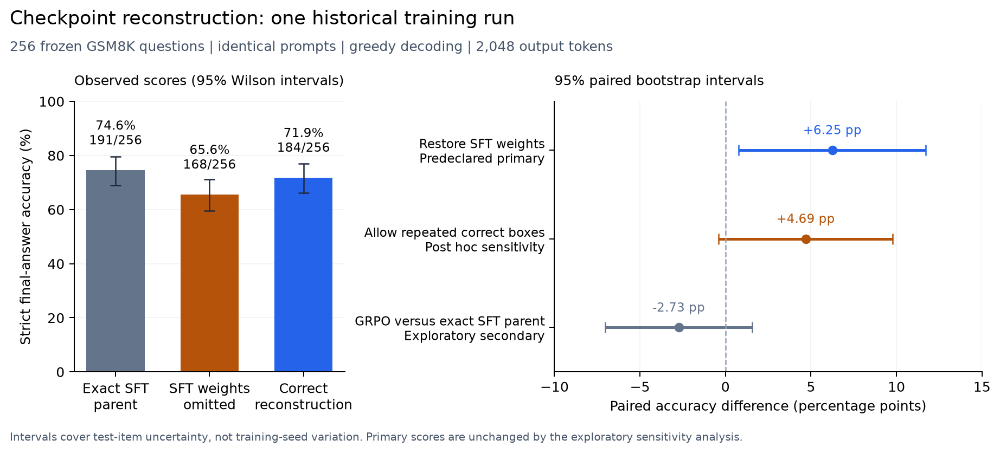

# Checkpoint-loading ablation: results and limitations

Completed: 2026-10-19

The accepted evaluation-only experiment completed all three 256-question arms. Restoring the omitted SFT contribution improves success under the predeclared output contract by 6.25 percentage points. That result is sensitive to four responses that repeat an identical correct boxed answer. The comparison with the exact SFT parent does not resolve whether this historical GRPO phase helped or harmed performance.

This supports a narrowly scoped reproducibility case study about checkpoint assembly and evaluation rules. It does not establish a general result about reasoning or reinforcement learning.

## Protocol and evidence

The [frozen protocol](../../results/proposals/checkpoint-ablation/6b95572ffeae5d5f98176ffd/protocol.json) selects 256 GSM8K test questions with seed 2026, excluding the 32 development-pilot questions. The benchmark had already been used historically; this is not a previously unseen test set. All arms receive identical prompts and boxed-answer instructions, greedy decoding, thinking enabled, and a 2,048-token output limit. No new training took place.

- **SFT parent:** the exact step-117 adapter used before the historical combined GRPO run.
- **SFT omitted:** original Qwen plus the final adapter from that combined run, intentionally reproducing the missing-parent construction. This is not the separate GRPO-only training run.
- **Correct reconstruction:** the exact reconstructed SFT parent plus that same final GRPO adapter.

Each construction passed exact CPU-logit parity on a fixed export/reload probe. All three complete weight files have distinct hashes. The corrected export binds the exact SFT parent's artifact identity. Each GPU evaluation was verified from a separate container. All 768 downloaded raw responses reproduce their saved primary scores on CPU; question IDs, ground truths, output hashes and evaluation identities reconcile.

The full-size reconstruction uses the declared pinned Qwen revision. The original historical base revision remains unverified. All three evaluation models use common BF16 merging; this does not test floating-point differences against the original unmerged-adapter loader. The historical GRPO adapter retains its legacy reward-training history. Original reported scores are preserved and are not replaced by these new subset measurements.

## Primary results

| Construction | Correct / 256 | Strict accuracy | Unfinished thinking | Format failures | Output limit reached |
|---|---:|---:|---:|---:|---:|
| Exact SFT parent | 191 | 74.61% | 45 | 7 | 53 |
| SFT omitted | 168 | 65.63% | 62 | 21 | 79 |
| Correct reconstruction | 184 | 71.88% | 56 | 3 | 59 |

Accuracy includes compliance with the explicit final-answer contract. Missing, malformed or multiple final boxes fail that contract. Unfinished thinking and format failures are separate score categories; the output-limit column overlaps them and must not be added to them.

**Predeclared primary comparison — correct reconstruction minus SFT omitted:** +16 correct answers, or **+6.25 percentage points**. The 95% paired bootstrap interval is **+0.78 to +11.72 points**. There are 34 questions only the corrected construction solves and 18 only the missing-SFT control solves. Exact two-sided McNemar p = **0.03648**.

**Exploratory secondary comparison — correct reconstruction minus its exact SFT parent:** -7 correct answers, or **-2.73 points**, with a 95% paired interval of **-7.03 to +1.56 points**; McNemar p = **0.28104**. The 12 gains and 19 losses do not resolve a performance decrease. Failure to resolve an effect is not evidence of equivalence.

The intervals use 10,000 paired question resamples with seed 42. They do not measure training-seed variability. There is one primary comparison; the secondary is explicitly exploratory.

## Material sensitivity to output format

Model-label-hidden review identified four responses in the missing-SFT arm that box the same correct number twice. Rejecting them follows the predeclared exactly-one-box instruction, but their numerical answers are semantically unambiguous.

In a separately recorded **post hoc exploratory sensitivity**, accepting those four repeated identical correct answers raises the control to 172/256 (67.19%). The restoration effect becomes **+4.69 points**, with a paired 95% interval of **-0.39 to +9.77 points** and McNemar p = **0.11140**. The primary scores remain unchanged.

The primary endpoint therefore shows a positive restoration effect, while the small-sample evidence is not robust to this reasonable relaxation of the format rule. Completion and formatting are material parts of these measurements. This is insufficient evidence for a general improvement in mathematical reasoning.

## Response review and archived-scorer diagnostic

The same coding assistant inspected the final fields of all 246 responses from 82 question groups with cross-arm correctness disagreement or archived-scorer disagreement. Model labels were withheld in the rendered review inputs; decisions were saved before unblinding. This was not independent human validation and did not assess reasoning faithfulness.

The inspected cases contained 108 correct complete boxed values, 17 incorrect boxed values, 93 unfinished-thinking responses, 23 truncated final responses without a box, one correct value at an unclosed box, and the four duplicated correct boxed values. The review's contract classifications agreed with all corresponding primary scores. The [review decisions](../../results/proposals/checkpoint-ablation/6b95572ffeae5d5f98176ffd/collected/blind-review-decisions.json), shuffled CSV and separate identity key are retained. The review did not overwrite primary scores.

CPU application of the archived legacy scorer to the **same newly prompted responses** counts 203, 197 and 200 correct answers for the SFT parent, missing-SFT control and correct reconstruction, respectively. These are diagnostics, not historical re-evaluations or a validated alternative primary metric. Of its 57 additional successes, 53 reach the output limit, including 31 with unfinished thinking; the remaining four are the repeated identical correct boxes. This demonstrates that the scoring rule changes measured success on these outputs. It cannot determine the error in the original historical table because those raw responses were not saved and this experiment changes the prompt/runtime.

## Execution, cost and software checks

The [Modal app](https://modal.com/apps/maxiruess/main/ap-vKGUikmJi87JOanH5v4HYi) ran from 17:08:13 to 18:02:47 UTC and is stopped with zero tasks. Client-observed evaluation calls took 1,067.2, 1,044.1 and 966.7 seconds. They generated 950,496 tokens in total. No paid task failed or was retried. An initial local invocation without `PYTHONPATH=.` failed before importing Modal or starting remote work; the documented invocation includes that environment setting.

The closing workspace snapshot reports **$1.86 additional metered usage** and **$0 additional billed cost after credits**, within the separately approved **$20 cap**. Billing can lag or be adjusted. Summing measured client wall times plus the reserved startup allowance at the bounded resource rates gives approximately **$2.14**; this is an estimate, not an invoice. Runtime reservations were $10.44, with another $8 allocated to setup and recovery. Unused budget was not spent on additional experiments.

The implementation passes **65 CPU tests plus 11 subtests**, including real tiny Qwen/PEFT construction and export/reload checks, subset integrity, stale-protocol rejection, budget limits and refusal to automatically retry a failed paid task. Ruff and formatting checks pass. The new collection boundary was also exercised against all 32 retained real pilot records. Code review was sequential in the primary context, with no independent-model review. Changes remain local and uncommitted.

## Reproduction pointers

- [Protocol and bounded execution instructions](checkpoint-ablation-2026-10-19.md)
- [Canonical outcome, hashes, cost evidence and stopped-app record](../../results/recovery/checkpoint-ablation-outcome.json)
- [Primary paired analysis](../../results/proposals/checkpoint-ablation/6b95572ffeae5d5f98176ffd/collected/analysis.json)
- [Separate post hoc sensitivity and scorer diagnostic](../../results/proposals/checkpoint-ablation/6b95572ffeae5d5f98176ffd/collected/exploratory-sensitivity.json)
- [Persistent execution ledger](../../outputs/checkpoint-ablation/00d4327ad01cc048cbc00739/ledger.json)
- [Implementation review and coverage limits](../reviews/2026-10-19-checkpoint-ablation-implementation.md)

The main multi-seed controlled study and historical full-benchmark correction remain unrun. This experiment's contribution is a measured, protocol-dependent checkpoint-loading case study, with its uncertainty and format sensitivity preserved.
